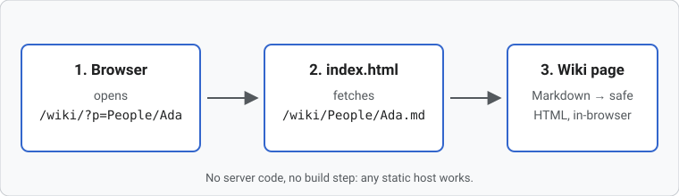

# Images and media

All media paths on this page are written **relative to this page's folder** (`Examples/`), so they work wherever the wiki is installed. View the source of this page to see exactly what was written.

## Markdown images

```markdown

```


A leading `/` means the wiki root, so `` is the same image from any page:


## Figures with captions

<figure class="thumb right">

<figcaption>A <code>figure.thumb.right</code> floats beside the text.</figcaption>
</figure>

Use `<figure>` and `<figcaption>` for captioned images. The classes `thumb`, `right`, `left` and `center` frame and position them. On a phone, floating figures stop floating and sit between paragraphs.

```html
<figure class="thumb right">
  
  <figcaption>A figure.thumb.right floats beside the text.</figcaption>
</figure>
```

The text keeps flowing around the figure until it ends. Add `<div class="clear"></div>` to push the next element below every float.

<div class="clear"></div>

<figure class="center">

<figcaption>A centered figure: <code>&lt;figure class="center"&gt;</code>.</figcaption>
</figure>

## Responsive images

`<picture>`, `srcset` and `sizes` work, and every URL is rewritten relative to the page:

```html
<picture>
  <source srcset="media/test-pattern-poster.jpg" media="(min-width: 600px)">
  
</picture>
```

<picture>
  <source srcset="media/test-pattern-poster.jpg" media="(min-width: 600px)">
  
</picture>

## Video

<video controls width="480" poster="media/test-pattern-poster.jpg" preload="metadata">
  <source src="media/test-pattern.webm" type="video/webm">
  <source src="media/test-pattern.mp4" type="video/mp4">
  Your browser can't play this video. <a href="media/test-pattern.mp4">Download it</a>.
</video>

```html
<video controls width="480" poster="media/test-pattern-poster.jpg" preload="metadata">
  <source src="media/test-pattern.webm" type="video/webm">
  <source src="media/test-pattern.mp4" type="video/mp4">
  Your browser can't play this video. <a href="media/test-pattern.mp4">Download it</a>.
</video>
```

## Audio

<audio controls src="media/chime.wav" preload="metadata"></audio>

```html
<audio controls src="media/chime.wav" preload="metadata"></audio>
```

## Links to files

Links to anything that is not a page are passed straight to the browser:

- [Spreadsheet data (CSV)](files/elements.csv)
- [The video file](media/test-pattern.mp4)
- <a href="files/elements.csv" download>Force a download with the <code>download</code> attribute</a>

## Embeds

`<iframe>` embeds are removed unless the site allows their host in [`iframeHosts`](../Configuration). This manual allows `www.youtube-nocookie.com`, but doesn't embed anything so that it works offline. The syntax is in [Links and media](../Links_and_Media#embedding-iframes).

This iframe points at a host that isn't allowed, so it has been removed and you see nothing between the lines:

---
<iframe src="https://example.com/" width="300" height="100"></iframe>

---
