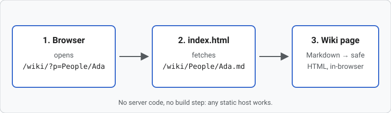
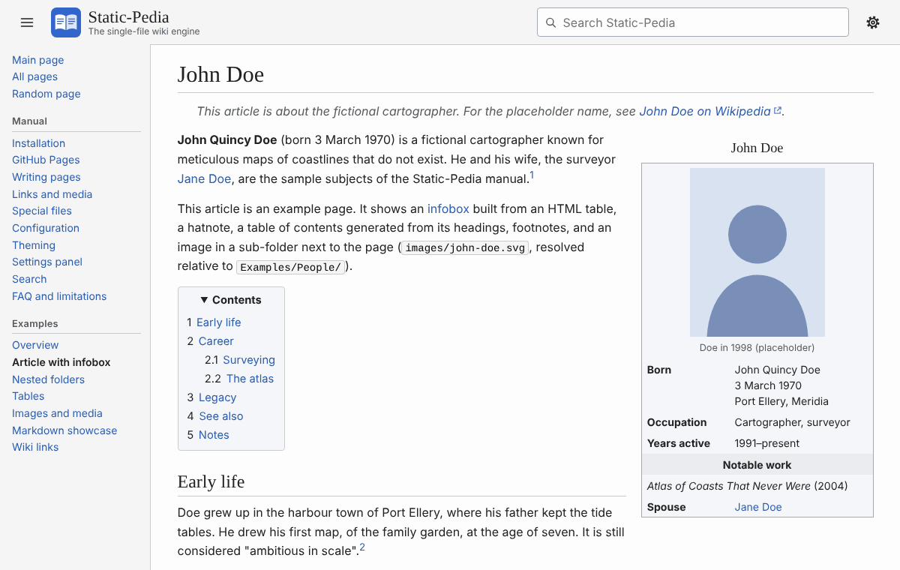
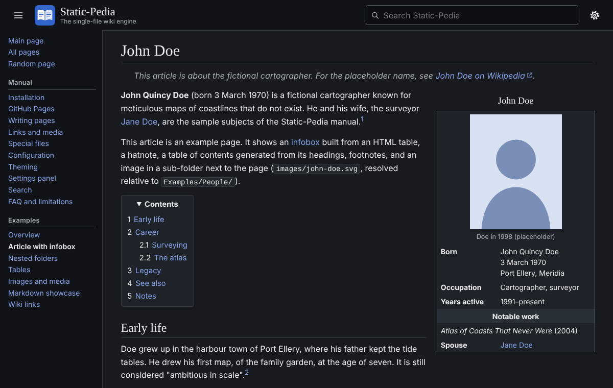

# Welcome to Static-Pedia

**Static-Pedia** is a read-only, wiki-style encyclopedia engine delivered as **one self-contained `index.html` file**. Put it at the top of a folder of Markdown files, upload the folder to any static web host, and the files become a browsable wiki. You get a sidebar, search, a table of contents on every long page, and light and dark themes.

This site *is* Static-Pedia. Every page you are reading is a plain `.md` file in the repository, rendered in your browser by `index.html`. It doubles as the reference manual: start with [Installation](Installation) or pick a topic from the sidebar.

<div class="feature-grid">
<div><strong>One file</strong>The whole program (parser, sanitizer, styles, icons) lives in <code>index.html</code>. No CDN, no fonts fetched from third parties, no build step.</div>
<div><strong>Any static host</strong>GitHub Pages, <code>python -m http.server</code>, nginx, S3, Netlify. Works at the domain root or under a sub-path like <code>/wiki/</code>.</div>
<div><strong>Plain Markdown</strong>GitHub-flavored Markdown with tables, task lists, footnotes, <code>[[wiki links]]</code> and sanitized HTML for infoboxes.</div>
<div><strong>Yours to restyle</strong>Every color and font is a CSS variable. Drop a <code>style.css</code> next to <code>index.html</code> to override them.</div>
</div>

## Quick start

1. Download <a href="index.html" download><code>index.html</code></a> from this site, or grab it from the [repository](https://github.com/evilsupervillain/staticpedia).
2. Put it in the folder that holds your Markdown, next to a file called `Index.md`. That file is your home page.
3. Serve the folder with any web server, for example:

   ```sh
   cd my-wiki
   python3 -m http.server 8000
   ```

4. Open <http://localhost:8000/>. A link to `?p=People/John_Doe` shows `People/John_Doe.md`.

A typical wiki looks like this:

```text
my-wiki/
├── index.html          ← Static-Pedia (the only program file)
├── Index.md            ← home page            → /my-wiki/
├── _Sidebar.md         ← optional navigation panel
├── People.md           ← a page               → ?p=People
└── People/
    ├── John_Doe.md     ← a page in a folder   → ?p=People/John_Doe
    └── images/
        └── portrait.png
```

> [!TIP]
> You can't open `index.html` by double-clicking it. Browsers block the requests it needs on `file://` URLs, so you always need a web server, even a local one. See [FAQ](FAQ#why-does-opening-indexhtml-from-disk-not-work).

## How it works



When someone visits `?p=People/Ada`, `index.html` fetches `People/Ada.md` from the same folder it was loaded from. It converts the Markdown to HTML, removes anything unsafe, rewrites relative links and images so they point at the right files, and shows the result. Clicking another wiki link swaps the page in place without a full reload, and the browser's Back and Forward buttons work as usual.

## What's in this manual

| Page | What it covers |
|---|---|
| [Installation](Installation) | Installing at the root or a sub-path, local preview, hosting options |
| [GitHub Pages](GitHub_Pages) | Publishing a wiki from a GitHub repository, step by step |
| [Writing pages](Writing_Pages) | File names, titles, front matter, Markdown syntax, raw HTML |
| [Links and media](Links_and_Media) | Page links, wiki links, anchors, images, video, audio, files |
| [Special files](Special_Files) | `_Sidebar.md`, `_Footer.md`, `style.css`, `pages.json`, `staticpedia.json` |
| [Configuration](Configuration) | Every option in `staticpedia.json` |
| [Theming](Theming) | CSS variables, dark mode, `style.css`, content classes |
| [Settings panel](Settings) | The gear menu, what readers can change, how it is stored |
| [Search](Search) | The search box, `pages.json`, the generator script, GitHub Actions |
| [FAQ and limitations](FAQ) | Troubleshooting and the things Static-Pedia deliberately does not do |

The [Examples](Examples/) section shows what the renderer can do: an [article with an infobox](Examples/People/John_Doe), [tables](Examples/Tables), [images and media](Examples/Images_and_Media), and a [tour of the Markdown syntax](Examples/Markdown_Showcase).

## Screenshots

<figure class="center">

<figcaption>An article in the light theme.</figcaption>
</figure>

<figure class="center">

<figcaption>The same page in the dark theme. Readers pick a theme from the gear menu.</figcaption>
</figure>
